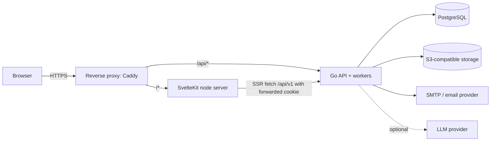

# ReefCare — Architecture

Status: **Draft for review** (Phase 0)

## 1. Overview

A **modular monolith**: one Go binary serving the REST API and running background workers, one
PostgreSQL database, a SvelteKit web app, and an S3-compatible object store (from Phase 4, or
earlier if livestock photos ship in MVP).



Same origin for web and API (via the proxy) keeps cookie auth simple and avoids CORS for the
first-party app.

## 2. Technology decisions

| Concern | Decision | Rationale |
|---|---|---|
| Language | Go (latest stable, ≥ 1.25) | Team requirement; simple deployment |
| Router | `go-chi/chi/v5` | Small, idiomatic, `net/http` compatible |
| DB driver | `jackc/pgx/v5` + `pgxpool` | Performance, native types |
| Query layer | `sqlc` (pgx/v5 engine) | Type-safe, SQL stays visible |
| Migrations | `pressly/goose/v3`, SQL files, embedded | Simple, runnable from binary and CLI |
| Database | PostgreSQL 18 | Current stable; native `uuidv7()` |
| Decimals | `shopspring/decimal` via sqlc override + `jackc/pgx-shopspring-decimal` | Exact NUMERIC round-trip |
| Validation | Explicit validation functions per command (no reflection tags) | Domain-specific rules, clear errors |
| Password hashing | Argon2id (`golang.org/x/crypto/argon2`) | OWASP recommended |
| Schedules | RRULE subset via `teambition/rrule-go` | Standard format; easy UI mapping |
| Jobs | In-house `jobs` table with `FOR UPDATE SKIP LOCKED` | Few dependencies; fully under our control. Alternative: `riverqueue/river` (decision D3) |
| Logging | `log/slog` JSON handler | Standard library |
| Metrics | Prometheus client (`/metrics` internal only) | De-facto standard |
| API docs | OpenAPI 3.1 at `api/openapi.yaml`, hand-written, contract tests | Design-first |
| Frontend | SvelteKit 2 + TypeScript + Svelte 5, adapter-node | Per brief |
| Charts | Apache ECharts (or LayerChart) — decided in Phase 2 | Annotations, time axes, accessibility |
| i18n | `paraglide-js` (frontend); message keys in API errors | Type-safe, small |
| Proxy / TLS | Caddy | Automatic HTTPS, simple config |
| Local object storage | S3-compatible container (e.g. Garage or SeaweedFS) — decided when media ships | MinIO community distribution status uncertain |

## 3. Repository layout

```text
cmd/api/main.go                 # wiring only: config → logger → db → services → server/workers
internal/
  app/                          # composition root helpers, worker registry
  config/                       # env parsing + validation
  platform/
    database/                   # pgxpool, tx helper, migrations embed
    httpserver/                 # router, middleware (request id, logging, recover, auth, csrf, rate limit), error envelope
    logging/  clock/  jobs/     # slog setup, Clock interface, job runner
  identity/  users/  tanks/  waterparameters/  dosing/  waterchanges/
  equipment/  livestock/  maintenance/  timeline/  knowledge/  intelligence/
  notifications/  community/  reputation/  moderation/  audit/
db/
  migrations/                   # goose SQL
  queries/                      # sqlc input, one file per module
  sqlc.yaml
api/openapi.yaml
web/                            # SvelteKit app
deploy/                         # Caddyfile, prod compose, backup scripts
scripts/  docs/
compose.yaml  Dockerfile  Makefile  .golangci.yml  .env.example
```

Packages are created when a phase needs them.

## 4. Module anatomy

Each domain module follows the same shape (files, not sub-packages, unless it grows):

```text
internal/dosing/
  domain.go        # types, invariants, pure functions (no I/O imports)
  schedule.go      # occurrence generation (pure, uses Clock input)
  service.go       # application service: authz, transactions, timeline events
  http.go          # handlers + request/response DTOs
  jobs.go          # job handlers owned by this module
  *_test.go
internal/db/       # sqlc output (package `dbq`), generated — never edited
```

### Dependency rules
1. `domain.go` imports only the standard library and small value libraries (decimal, uuid).
2. `service.go` depends on `dbq`, `platform/database` (tx), `platform/clock`, and other modules'
   **service interfaces** (e.g. `timeline.Recorder`, `tanks.Authorizer`), never their tables.
3. `http.go` depends on its own service and `platform/httpserver`.
4. No import cycles: shared primitives live in `tanks` (authorization) and `timeline` (recorder),
   which do not import feature modules.
5. No global state; everything constructed in `cmd/api`.

### Transactions
`database.InTx(ctx, pool, func(q *dbq.Queries) error)` is the only way to start one. Services open
transactions; the timeline recorder and job enqueuer accept the `*dbq.Queries` bound to that tx, so
domain writes, timeline events and follow-up jobs commit atomically (transactional outbox pattern
without a separate broker).

### Authorization
`tanks.Authorizer.Require(ctx, actor, tankID, tanks.PermRead|PermWrite)` is called in every service
method touching tank data. For resources addressed by their own ID (`/dosing-plans/{id}`), the
service loads the resource's `tank_id` first (single query joining ownership), then authorizes.
Failure on read → `ErrNotFound`; failure on write after read is permitted → `ErrForbidden`.

Module data access: a module owns its tables, but may read another module's tables
through its own sqlc queries when it only needs a few stable columns. Today `tanks` reads
`users.id`, `status`, `email_verified_at`, `display_name` and `username` (owner state,
share grantees). Writes to another module's tables always go through that module's service.

### Errors
Domain/service errors are typed (`apperr.NotFound`, `apperr.Validation{Fields}`,
`apperr.Conflict{Code}`, `apperr.Forbidden`, `apperr.RateLimited`). A single HTTP mapper converts
them to the envelope in [api-guidelines.md](api-guidelines.md). Unknown errors → 500 with request id;
details only in logs.

## 5. Background work

- `jobs` table: `id, kind, dedupe_key UNIQUE, payload JSONB, run_at, status, attempts,
  max_attempts, last_error, locked_by, locked_until, created_at`.
- Workers (bounded pool, default 4) poll with `FOR UPDATE SKIP LOCKED`, exponential backoff,
  `locked_until` lease so crashed workers' jobs are retried.
- Handlers must be idempotent: they re-check state and use unique constraints
  (e.g. notification `dedupe_key`).
- Periodic schedulers (every minute, via a `jobs` row that re-enqueues itself with a dedupe key per
  time bucket):
  - `dosing.materialize` — create occurrences for the next 7 days per active plan.
  - `dosing.mark_missed` — occurrences past grace period → `missed`.
  - `waterchanges.materialize`, `maintenance.due_check`.
  - `waterparameters.staleness_check` (daily per tank in tank owner's timezone).
  - `notifications.deliver_email`.
- In-memory timers are never the source of truth.

## 6. Configuration

Environment variables (validated at startup, fail fast with a list of all problems):
`APP_ENV`, `HTTP_ADDR`, `DATABASE_URL`, `DB_MAX_CONNS`, `PUBLIC_BASE_URL`, `CORS_ALLOWED_ORIGINS`,
`SESSION_TTL`, `COOKIE_SECURE`, `SMTP_*`, `S3_*`, `LLM_PROVIDER` (default `none`),
`JOB_WORKERS`, `LOG_LEVEL`. Secrets only from environment / secret manager.

## 7. Environments

| Env | Description |
|---|---|
| dev | `compose.yaml`: postgres (healthcheck, volume), mailpit, api (air hot reload optional), web dev server |
| test | ephemeral PostgreSQL (compose service `db-test` or testcontainers); migrations applied per run |
| prod | single VM or managed container service + managed PostgreSQL; Caddy; nightly `pg_dump` + WAL archiving decision in Phase 5 |

## 8. Observability

- Middleware: request id (`X-Request-ID`), structured access log (method, route pattern, status,
  latency, user id hash), panic recovery.
- `/healthz` (process up), `/readyz` (DB ping + migration version matches embedded).
- Metrics: HTTP latency/status by route, DB pool stats, job queue depth/latency/failures.
- Graceful shutdown: SIGTERM → stop accepting → drain HTTP (30 s) → stop workers after current job
  → close pool.

## 9. CI

GitHub Actions (assumed; decision D9): `gofmt` check, `go vet`, `golangci-lint`, `sqlc diff`,
`go test -race`, integration tests against a PostgreSQL service container, migration up/down/up,
`govulncheck`, web `check`/`lint`/`test`/`build`, Docker build.
