# ReefCare — Database Design

Status: **Draft for review** (Phase 0). DDL below is a design sketch; the authoritative schema will
be the Goose migrations in `db/migrations/`.

## 1. Conventions

- PostgreSQL 18. Extensions: `citext` (case-insensitive email/username).
- PKs: `uuid DEFAULT uuidv7()` (time-ordered, good index locality). Lookup/catalog tables with
  stable codes use `text` PKs (e.g. `parameter_types.code`).
- Timestamps: `timestamptz`; `created_at NOT NULL DEFAULT now()`; mutable tables add
  `updated_at` and `version int NOT NULL DEFAULT 1` (optimistic concurrency).
- Quantities: `numeric(12,4)` unless stated; units as `text` validated against a CHECK list or FK.
- Enumerations: `text` + `CHECK (x IN (...))` (easier to evolve than PG enums).
- FKs: historical data `ON DELETE RESTRICT`; pure child rows (`tank_shares`) `ON DELETE CASCADE`.
- Tank data is never hard-deleted through the API; account deletion follows
  [security.md](security.md) §Privacy.
- Pagination: keyset on `(sort_col, id)`.

## 2. ER diagram (MVP + Release 2)

```mermaid
erDiagram
  users ||--o{ user_sessions : has
  users ||--o{ user_roles : has
  users ||--o{ tanks : owns
  tanks ||--o{ tank_shares : "shared via"
  users ||--o{ tank_shares : "granted"
  tanks ||--o{ parameter_targets : has
  parameter_types ||--o{ parameter_targets : for
  tanks ||--o{ water_tests : has
  water_tests ||--|{ water_test_readings : contains
  parameter_types ||--o{ water_test_readings : measures
  water_test_readings |o--o| water_test_readings : supersedes
  dosing_products ||--o{ dosing_plans : used_by
  dosing_products ||--o{ product_stocks : stocked_as
  tanks ||--o{ dosing_plans : has
  dosing_plans ||--o{ dosing_events : generates
  tanks ||--o{ dosing_events : has
  tanks ||--o{ water_change_schedules : has
  water_change_schedules ||--o{ water_change_events : generates
  tanks ||--o{ water_change_events : has
  equipment_models ||--o{ tank_equipment : instance_of
  tanks ||--o{ tank_equipment : has
  tank_equipment ||--o{ equipment_configurations : versions
  tanks ||--o{ maintenance_plans : has
  maintenance_plans ||--o{ maintenance_events : generates
  tank_equipment |o--o{ maintenance_plans : for
  species ||--o{ livestock_entries : of
  tanks ||--o{ livestock_entries : has
  livestock_entries ||--o{ livestock_events : has
  tanks ||--o{ tank_events : timeline
  knowledge_articles ||--|{ knowledge_article_versions : versions
  knowledge_article_versions }o--o{ knowledge_sources : cites
  tanks ||--o{ assessments : has
  assessments ||--o{ assessment_evidence : supported_by
  assessments }o--o{ knowledge_article_versions : references
  assessments ||--o{ assessment_feedback : receives
  users ||--o{ notifications : receives
  users ||--o{ posts : writes
  posts ||--o| case_snapshots : freezes
  posts ||--o{ comments : has
  posts ||--o{ case_updates : has
  users ||--o{ votes : casts
  users ||--o{ reputation_ledger : earns
  users ||--o{ user_badges : earns
  badges ||--o{ user_badges : awarded
  users ||--o{ moderation_reports : files
  users ||--o{ audit_logs : acts
```



Relationship rationale (major ones):
- **users → tanks (1:N, RESTRICT)**: single owner; account deletion handles tanks explicitly.
- **tanks → tank_shares (1:N, CASCADE)**: shares have no meaning without the tank.
- **water_tests → readings (1:N)**: a session groups readings measured together; each reading still
  carries its own method/kit because one session may mix kits.
- **readings self-reference (supersedes)**: corrections without overwriting history.
- **dosing_plans → dosing_events (1:N, nullable plan)**: ad-hoc doses have no plan; occurrences
  are unique per `(plan_id, scheduled_for)`.
- **tank_equipment → equipment_configurations (1:N)**: versioned settings; current = max version.
- **livestock_entries → livestock_events (1:N)**: quantity derived from events.
- **tank_events**: polymorphic projection `(source_type, source_id)` — no FK by design (multiple
  source tables); integrity guaranteed by writing in the same transaction.
- **assessments → knowledge_article_versions (M:N)**: references pin an exact *version*, so
  history stays explainable after articles change.
- **posts → case_snapshots (1:0..1)**: immutable JSONB snapshot of shared tank context.

## 3. DDL sketch — Phase 1 (identity, tanks, audit, jobs)

```sql
CREATE EXTENSION IF NOT EXISTS citext;

CREATE TABLE users (
  id               uuid PRIMARY KEY DEFAULT uuidv7(),
  email            citext NOT NULL UNIQUE,
  email_verified_at timestamptz,
  password_hash    text NOT NULL,
  display_name     text NOT NULL CHECK (char_length(display_name) BETWEEN 1 AND 60),
  username         citext UNIQUE CHECK (username ~ '^[a-z0-9_]{3,30}$'),
  bio              text CHECK (char_length(bio) <= 1000),
  experience_level text CHECK (experience_level IN ('beginner','intermediate','advanced','professional')),
  locale           text NOT NULL DEFAULT 'vi' CHECK (locale IN ('vi','en')),
  timezone         text NOT NULL DEFAULT 'Asia/Ho_Chi_Minh',
  unit_prefs       jsonb NOT NULL DEFAULT '{}',      -- display-only preferences
  notification_prefs jsonb NOT NULL DEFAULT '{}',
  status           text NOT NULL DEFAULT 'active' CHECK (status IN ('active','suspended','deactivated')),
  deactivated_at   timestamptz,
  created_at       timestamptz NOT NULL DEFAULT now(),
  updated_at       timestamptz NOT NULL DEFAULT now(),
  version          int NOT NULL DEFAULT 1
);

CREATE TABLE user_roles (
  user_id    uuid NOT NULL REFERENCES users(id) ON DELETE CASCADE,
  role       text NOT NULL CHECK (role IN ('moderator','administrator')),
  granted_by uuid REFERENCES users(id) ON DELETE SET NULL,
  granted_at timestamptz NOT NULL DEFAULT now(),
  PRIMARY KEY (user_id, role)
);

CREATE TABLE user_sessions (
  id           uuid PRIMARY KEY DEFAULT uuidv7(),
  user_id      uuid NOT NULL REFERENCES users(id) ON DELETE CASCADE,
  token_hash   bytea NOT NULL UNIQUE,          -- SHA-256 of the random 32-byte token
  csrf_secret  bytea NOT NULL,
  created_at   timestamptz NOT NULL DEFAULT now(),
  last_seen_at timestamptz NOT NULL DEFAULT now(),
  expires_at   timestamptz NOT NULL,
  revoked_at   timestamptz,
  user_agent   text,
  ip_prefix    inet                            -- truncated (/24, /48) for privacy
);
CREATE INDEX ON user_sessions (user_id) WHERE revoked_at IS NULL;

CREATE TABLE auth_tokens (                     -- email verification, password reset
  id          uuid PRIMARY KEY DEFAULT uuidv7(),
  user_id     uuid NOT NULL REFERENCES users(id) ON DELETE CASCADE,
  purpose     text NOT NULL CHECK (purpose IN ('verify_email','reset_password')),
  token_hash  bytea NOT NULL UNIQUE,
  expires_at  timestamptz NOT NULL,
  used_at     timestamptz,
  created_at  timestamptz NOT NULL DEFAULT now()
);

-- Implemented in db/migrations/00004_tanks.sql with these differences: `filtration` and
-- `visibility` are deferred until the equipment module (2.6) and public case snapshots
-- (Phase 4) need them; `archived_at` (CHECK: set iff status = 'archived'), a CHECK that
-- dimensions are all set or all null, text length limits, and `tank_shares.granted_by`
-- were added. `auth_tokens.email` (00003) binds a token to the address it was sent to.
CREATE TABLE tanks (
  id                    uuid PRIMARY KEY DEFAULT uuidv7(),
  owner_id              uuid NOT NULL REFERENCES users(id) ON DELETE RESTRICT,
  name                  text NOT NULL CHECK (char_length(name) BETWEEN 1 AND 80),
  description           text CHECK (char_length(description) <= 4000),
  tank_type             text NOT NULL CHECK (tank_type IN ('fish_only','fowlr','mixed_reef','sps_dominant','lps_dominant','soft_coral','custom')),
  status                text NOT NULL DEFAULT 'cycling' CHECK (status IN ('cycling','active','paused','archived')),
  length_cm             numeric(7,1) CHECK (length_cm > 0),
  width_cm              numeric(7,1) CHECK (width_cm > 0),
  height_cm             numeric(7,1) CHECK (height_cm > 0),
  display_volume_l      numeric(9,2) NOT NULL CHECK (display_volume_l > 0),
  sump_volume_l         numeric(9,2) CHECK (sump_volume_l >= 0),
  system_volume_l       numeric(9,2) NOT NULL CHECK (system_volume_l > 0),   -- user's estimate of total water
  setup_date            date,
  water_source          text,
  salt_mix              text,
  filtration            jsonb NOT NULL DEFAULT '{}',   -- free-form description until equipment module covers it
  visibility            jsonb NOT NULL DEFAULT '{}',   -- per-category share flags for public snapshots
  created_at            timestamptz NOT NULL DEFAULT now(),
  updated_at            timestamptz NOT NULL DEFAULT now(),
  version               int NOT NULL DEFAULT 1
);
CREATE INDEX ON tanks (owner_id, created_at DESC);

CREATE TABLE tank_shares (
  tank_id     uuid NOT NULL REFERENCES tanks(id) ON DELETE CASCADE,
  user_id     uuid NOT NULL REFERENCES users(id) ON DELETE CASCADE,
  permission  text NOT NULL DEFAULT 'viewer' CHECK (permission IN ('viewer')),
  created_at  timestamptz NOT NULL DEFAULT now(),
  PRIMARY KEY (tank_id, user_id)
);
CREATE INDEX ON tank_shares (user_id);

CREATE TABLE audit_logs (
  id          bigint GENERATED ALWAYS AS IDENTITY PRIMARY KEY,
  actor_id    uuid REFERENCES users(id) ON DELETE SET NULL,
  action      text NOT NULL,                 -- e.g. 'auth.login', 'tank.share.grant'
  target_type text,
  target_id   uuid,
  metadata    jsonb NOT NULL DEFAULT '{}',   -- never secrets
  request_id  text,
  ip_prefix   inet,
  created_at  timestamptz NOT NULL DEFAULT now()
);
CREATE INDEX ON audit_logs (actor_id, created_at DESC);
CREATE INDEX ON audit_logs (target_type, target_id, created_at DESC);

CREATE TABLE idempotency_keys (
  user_id       uuid NOT NULL REFERENCES users(id) ON DELETE CASCADE,
  key           text NOT NULL CHECK (char_length(key) BETWEEN 8 AND 128),
  request_hash  bytea NOT NULL,              -- method + route + body hash; mismatch → 422
  response_status int,
  response_body jsonb,
  created_at    timestamptz NOT NULL DEFAULT now(),
  PRIMARY KEY (user_id, key)
);                                            -- purged after 48 h

-- Implemented in db/migrations/00005_jobs.sql with: status 'failed' dropped (a failed run
-- returns to 'pending' with a later run_at, or becomes 'dead'), locked_by for fencing,
-- finished_at, payload size limit, and partial indexes jobs_ready (pending by run_at) and
-- jobs_leased (running by locked_until). The same migration adds users.erased_at.
CREATE TABLE jobs (
  id           bigint GENERATED ALWAYS AS IDENTITY PRIMARY KEY,
  kind         text NOT NULL,
  dedupe_key   text,
  payload      jsonb NOT NULL DEFAULT '{}',
  run_at       timestamptz NOT NULL DEFAULT now(),
  status       text NOT NULL DEFAULT 'pending' CHECK (status IN ('pending','running','succeeded','failed','dead')),
  attempts     int NOT NULL DEFAULT 0,
  max_attempts int NOT NULL DEFAULT 10,
  locked_until timestamptz,
  last_error   text,
  created_at   timestamptz NOT NULL DEFAULT now(),
  updated_at   timestamptz NOT NULL DEFAULT now()
);
CREATE UNIQUE INDEX jobs_dedupe ON jobs (kind, dedupe_key) WHERE dedupe_key IS NOT NULL;
CREATE INDEX jobs_ready ON jobs (run_at) WHERE status IN ('pending','running');
```

## 4. DDL sketch — Phase 2 (reef management)

```sql
CREATE TABLE parameter_types (
  code            text PRIMARY KEY,                 -- 'alkalinity', 'calcium', ...
  canonical_unit  text NOT NULL,
  allowed_units   text[] NOT NULL,
  hard_min        numeric(12,4) NOT NULL,           -- physically/analytically impossible outside
  hard_max        numeric(12,4) NOT NULL,
  default_freshness interval NOT NULL,
  owner_id        uuid REFERENCES users(id),        -- NULL = system; non-null = user custom
  display_order   int NOT NULL DEFAULT 100,
  CHECK (hard_min < hard_max)
);

CREATE TABLE parameter_targets (
  id            uuid PRIMARY KEY DEFAULT uuidv7(),
  tank_id       uuid NOT NULL REFERENCES tanks(id) ON DELETE RESTRICT,
  parameter     text NOT NULL REFERENCES parameter_types(code),
  min_value     numeric(12,4),
  ideal_value   numeric(12,4),
  max_value     numeric(12,4),
  freshness     interval,
  valid_from    timestamptz NOT NULL DEFAULT now(),
  valid_to      timestamptz,                       -- NULL = current
  created_by    uuid NOT NULL REFERENCES users(id),
  CHECK (min_value IS NULL OR max_value IS NULL OR min_value <= max_value),
  CHECK (ideal_value IS NULL OR ((min_value IS NULL OR ideal_value >= min_value) AND (max_value IS NULL OR ideal_value <= max_value)))
);
CREATE UNIQUE INDEX parameter_targets_current ON parameter_targets (tank_id, parameter) WHERE valid_to IS NULL;

CREATE TABLE water_tests (
  id           uuid PRIMARY KEY DEFAULT uuidv7(),
  tank_id      uuid NOT NULL REFERENCES tanks(id) ON DELETE RESTRICT,
  measured_at  timestamptz NOT NULL,
  recorded_at  timestamptz NOT NULL DEFAULT now(),
  source       text NOT NULL CHECK (source IN ('manual','imported','sensor')),
  recorded_by  uuid REFERENCES users(id) ON DELETE SET NULL,
  integration_id uuid,                              -- future: device/integration
  notes        text CHECK (char_length(notes) <= 2000)
);
CREATE INDEX ON water_tests (tank_id, measured_at DESC);

CREATE TABLE water_test_readings (
  id              uuid PRIMARY KEY DEFAULT uuidv7(),
  water_test_id   uuid NOT NULL REFERENCES water_tests(id) ON DELETE RESTRICT,
  tank_id         uuid NOT NULL REFERENCES tanks(id) ON DELETE RESTRICT,   -- denormalized for trend index
  parameter       text NOT NULL REFERENCES parameter_types(code),
  measured_at     timestamptz NOT NULL,                                    -- copied from water_test
  input_value     numeric(12,4) NOT NULL,
  input_unit      text NOT NULL,
  canonical_value numeric(12,4) NOT NULL,
  method          text CHECK (method IN ('titration','colorimetric','photometer','refractometer','hydrometer','probe','icp','other')),
  test_kit        text,
  status          text NOT NULL DEFAULT 'valid' CHECK (status IN ('valid','flagged','superseded')),
  supersedes_id   uuid REFERENCES water_test_readings(id),
  correction_reason text,
  created_at      timestamptz NOT NULL DEFAULT now(),
  CHECK ((supersedes_id IS NULL) = (correction_reason IS NULL))
);
CREATE INDEX readings_trend ON water_test_readings (tank_id, parameter, measured_at DESC) WHERE status <> 'superseded';
CREATE UNIQUE INDEX readings_one_correction ON water_test_readings (supersedes_id) WHERE supersedes_id IS NOT NULL;

CREATE TABLE dosing_products (
  id             uuid PRIMARY KEY DEFAULT uuidv7(),
  owner_id       uuid REFERENCES users(id) ON DELETE CASCADE,   -- NULL = curated global product
  name           text NOT NULL,
  manufacturer   text,
  category       text NOT NULL CHECK (category IN ('alkalinity','calcium','magnesium','all_in_one','trace','nitrate','phosphate','carbon','bacteria','other')),
  components     jsonb NOT NULL DEFAULT '[]',   -- [{parameter, amount_per_unit, unit, source_ref}] only when documented
  dosage_instructions text,
  amount_unit    text NOT NULL CHECK (amount_unit IN ('ml','g','drops','capsule')),
  warnings       text,
  documentation_url text,
  review_status  text NOT NULL DEFAULT 'unreviewed' CHECK (review_status IN ('unreviewed','reviewed')),
  created_at     timestamptz NOT NULL DEFAULT now(),
  updated_at     timestamptz NOT NULL DEFAULT now()
);

CREATE TABLE product_stocks (
  id            uuid PRIMARY KEY DEFAULT uuidv7(),
  owner_id      uuid NOT NULL REFERENCES users(id) ON DELETE CASCADE,
  product_id    uuid NOT NULL REFERENCES dosing_products(id) ON DELETE RESTRICT,
  initial_amount numeric(12,4) NOT NULL CHECK (initial_amount > 0),
  remaining_amount numeric(12,4) NOT NULL CHECK (remaining_amount >= 0),
  batch         text, expires_on date, opened_on date,
  low_threshold numeric(12,4),
  status        text NOT NULL DEFAULT 'in_use' CHECK (status IN ('in_use','finished','discarded')),
  created_at    timestamptz NOT NULL DEFAULT now(),
  version       int NOT NULL DEFAULT 1
);

-- Implemented in db/migrations/00007_dosing.sql (milestone 2.4) with: no product_stocks yet
-- (open item DS1); dosing_products has form/default_unit and owner_id NULL = curated;
-- plans drop stock_id, target_parameters (wait for the parameter catalog, 2.1) and the
-- 'integration' delivery method; events drop 'cancelled' (edits delete upcoming rows),
-- add missed_after/missed_at/resolved_at/notes and per-row idempotency_key + request_hash
-- (UNIQUE per recorded_by) instead of a shared idempotency_keys table.
CREATE TABLE dosing_plans (
  id              uuid PRIMARY KEY DEFAULT uuidv7(),
  tank_id         uuid NOT NULL REFERENCES tanks(id) ON DELETE RESTRICT,
  product_id      uuid NOT NULL REFERENCES dosing_products(id) ON DELETE RESTRICT,
  stock_id        uuid REFERENCES product_stocks(id) ON DELETE SET NULL,
  amount          numeric(12,4) NOT NULL CHECK (amount > 0),
  amount_unit     text NOT NULL,
  rrule           text NOT NULL,                  -- validated subset
  timezone        text NOT NULL,
  starts_on       date NOT NULL,
  ends_on         date,
  delivery_method text NOT NULL CHECK (delivery_method IN ('manual','dosing_pump','integration')),
  target_parameters text[] NOT NULL DEFAULT '{}',
  status          text NOT NULL DEFAULT 'active' CHECK (status IN ('active','paused','completed')),
  materialized_until timestamptz,
  notes           text,
  created_at      timestamptz NOT NULL DEFAULT now(),
  updated_at      timestamptz NOT NULL DEFAULT now(),
  version         int NOT NULL DEFAULT 1,
  CHECK (ends_on IS NULL OR ends_on >= starts_on)
);
CREATE INDEX ON dosing_plans (tank_id) WHERE status = 'active';

CREATE TABLE dosing_events (
  id              uuid PRIMARY KEY DEFAULT uuidv7(),
  tank_id         uuid NOT NULL REFERENCES tanks(id) ON DELETE RESTRICT,
  plan_id         uuid REFERENCES dosing_plans(id) ON DELETE RESTRICT,
  product_id      uuid NOT NULL REFERENCES dosing_products(id) ON DELETE RESTRICT,
  scheduled_for   timestamptz,
  planned_amount  numeric(12,4),
  actual_amount   numeric(12,4) CHECK (actual_amount >= 0),
  amount_unit     text NOT NULL,
  status          text NOT NULL CHECK (status IN ('scheduled','completed','partial','skipped','failed','missed','cancelled')),
  executed_at     timestamptz,
  reported_by     text CHECK (reported_by IN ('manual','device')),
  reason          text,
  recorded_by     uuid REFERENCES users(id) ON DELETE SET NULL,
  created_at      timestamptz NOT NULL DEFAULT now(),
  updated_at      timestamptz NOT NULL DEFAULT now(),
  version         int NOT NULL DEFAULT 1,
  CHECK (plan_id IS NOT NULL OR scheduled_for IS NULL),
  CHECK (status NOT IN ('completed','partial') OR (executed_at IS NOT NULL AND actual_amount IS NOT NULL)),
  CHECK (status NOT IN ('skipped','failed') OR reason IS NOT NULL)
);
CREATE UNIQUE INDEX dosing_occurrence_unique ON dosing_events (plan_id, scheduled_for) WHERE plan_id IS NOT NULL;
CREATE INDEX ON dosing_events (tank_id, coalesce(executed_at, scheduled_for) DESC);
CREATE INDEX dosing_due ON dosing_events (scheduled_for) WHERE status = 'scheduled';

-- Implemented in db/migrations/00006_water_changes.sql (milestone 2.5) with: statuses
-- scheduled|completed|skipped ('cancelled' dropped: edits delete only upcoming rows),
-- resolved_at (when the keeper acted) separate from completed_at (when the water was
-- changed), skip_reason required for skipped, recorded_by/created_by. Salinity and
-- temperature fields and pre/post water-test links wait for 2.1/2.2 (they need the
-- parameter catalog's units).
-- water_change_schedules / water_change_events: same shape as dosing plans/events
--   (rrule, timezone, planned_volume_l; events: scheduled_for, status scheduled|completed|skipped|cancelled,
--    actual_volume_l, salt_mix, target_/measured_salinity, target_/measured_temp_c, prep_notes,
--    pre_test_id / post_test_id → water_tests). Overdue is derived: status='scheduled' AND scheduled_for < now() - grace.
--   UNIQUE (schedule_id, scheduled_for).

-- Implemented in db/migrations/00008_equipment_maintenance.sql (milestone 2.6) with: no
-- equipment_models catalog yet (manufacturer/model/name are text on tank_equipment, open item
-- EQ1); no status column (removed_at IS NULL = installed); composite FKs (equipment_id, tank_id)
-- keep configurations, plans and events on the device's tank; settings is a flat jsonb object
-- ≤ 8 KB; plans use interval_days 1..730 + timezone + starts_on and store next_due_on (local
-- date, recomputed on perform/edit), with overdue derived; events carry title, optional plan_id
-- and equipment_id, no consumables yet. Original sketch:
-- equipment_models(id, category, manufacturer, model, specs jsonb, owner_id NULL=global)
-- tank_equipment(id, tank_id, model_id NULL, display_name, category, serial_number, purchased_on,
--   warranty_until, installed_at, removed_at, status, version)
-- equipment_configurations(id, tank_equipment_id, version_no, settings jsonb, effective_at, note,
--   created_by, UNIQUE(tank_equipment_id, version_no))
-- maintenance_plans(id, tank_id, tank_equipment_id NULL, title, interval interval, next_due_at, active)
-- maintenance_events(id, plan_id NULL, tank_id, performed_at, notes, consumables jsonb)

-- Implemented in db/migrations/00009_livestock.sql (milestone 2.7) with: species.owner_id
-- RESTRICT (erasure deletes own species explicitly) and at least one name; livestock_entries
-- has category (defaults to the species'), added_at, notes, created_by and an idempotency key,
-- no status column (current_quantity = 0 means gone); livestock_events has a composite FK
-- (entry_id, tank_id), a note instead of details jsonb (required for observations) and an
-- idempotency key. Original sketch:
CREATE TABLE species (
  id               uuid PRIMARY KEY DEFAULT uuidv7(),
  category         text NOT NULL CHECK (category IN ('fish','coral','invertebrate','other')),
  coral_type       text CHECK (coral_type IN ('sps','lps','soft','non_photosynthetic')),
  common_name_vi   text, common_name_en text,
  scientific_name  text,
  owner_id         uuid REFERENCES users(id) ON DELETE CASCADE   -- NULL = curated
);

CREATE TABLE livestock_entries (
  id               uuid PRIMARY KEY DEFAULT uuidv7(),
  tank_id          uuid NOT NULL REFERENCES tanks(id) ON DELETE RESTRICT,
  species_id       uuid REFERENCES species(id) ON DELETE RESTRICT,
  display_name     text NOT NULL,
  current_quantity int NOT NULL DEFAULT 0 CHECK (current_quantity >= 0),   -- cache of Σ events
  form             text CHECK (form IN ('frag','colony','individual','group')),
  location_note    text,
  source_note      text,
  status           text NOT NULL DEFAULT 'present' CHECK (status IN ('present','gone')),
  created_at       timestamptz NOT NULL DEFAULT now(),
  updated_at       timestamptz NOT NULL DEFAULT now(),
  version          int NOT NULL DEFAULT 1
);

CREATE TABLE livestock_events (
  id               uuid PRIMARY KEY DEFAULT uuidv7(),
  entry_id         uuid NOT NULL REFERENCES livestock_entries(id) ON DELETE RESTRICT,
  tank_id          uuid NOT NULL REFERENCES tanks(id) ON DELETE RESTRICT,
  event_type       text NOT NULL CHECK (event_type IN ('added','died','transferred_in','transferred_out','sold','reconciliation','health_observation','treatment')),
  quantity_delta   int NOT NULL,
  occurred_at      timestamptz NOT NULL,
  details          jsonb NOT NULL DEFAULT '{}',   -- symptoms, color/tissue condition, treatment
  note             text,
  recorded_by      uuid REFERENCES users(id) ON DELETE SET NULL,
  created_at       timestamptz NOT NULL DEFAULT now(),
  CHECK (event_type IN ('added','transferred_in') AND quantity_delta > 0
      OR event_type IN ('died','transferred_out','sold') AND quantity_delta < 0
      OR event_type = 'reconciliation' AND quantity_delta <> 0
      OR event_type IN ('health_observation','treatment') AND quantity_delta = 0)
);
CREATE INDEX ON livestock_events (entry_id, occurred_at);

CREATE TABLE tank_events (
  id           uuid PRIMARY KEY DEFAULT uuidv7(),
  tank_id      uuid NOT NULL REFERENCES tanks(id) ON DELETE RESTRICT,
  occurred_at  timestamptz NOT NULL,
  category     text NOT NULL CHECK (category IN ('measurement','dosing','water_change','equipment','maintenance','livestock','symptom','treatment','milestone','note','assessment')),
  event_type   text NOT NULL,                 -- e.g. 'dosing.completed'
  source_type  text NOT NULL,
  source_id    uuid NOT NULL,
  actor_id     uuid REFERENCES users(id) ON DELETE SET NULL,
  summary      jsonb NOT NULL DEFAULT '{}',   -- small, render-ready, i18n keys + params
  created_at   timestamptz NOT NULL DEFAULT now(),
  UNIQUE (source_type, source_id, event_type)
);
CREATE INDEX tank_events_feed ON tank_events (tank_id, occurred_at DESC, id DESC);
CREATE INDEX tank_events_cat ON tank_events (tank_id, category, occurred_at DESC);

CREATE TABLE notifications (
  id          uuid PRIMARY KEY DEFAULT uuidv7(),
  user_id     uuid NOT NULL REFERENCES users(id) ON DELETE CASCADE,
  tank_id     uuid REFERENCES tanks(id) ON DELETE CASCADE,
  category    text NOT NULL,
  dedupe_key  text NOT NULL,                  -- e.g. 'dosing.missed:<event_id>'
  payload     jsonb NOT NULL,
  read_at     timestamptz,
  email_status text CHECK (email_status IN ('pending','sent','failed','skipped')),
  created_at  timestamptz NOT NULL DEFAULT now(),
  UNIQUE (user_id, dedupe_key)
);
CREATE INDEX ON notifications (user_id, created_at DESC) WHERE read_at IS NULL;
```

## 5. Phase 3 — knowledge and intelligence (summary)

Knowledge implemented in `db/migrations/00013_knowledge.sql` (milestone 3.1): versions are per
locale with `UNIQUE (article_id, locale, version_no)`, one published version per article and
locale (partial unique index), `structured jsonb` (verifications, recommendations with claim
class, contraindications, safety_warnings), `author_id`/`reviewed_by` with a four-eyes CHECK, a
trigger enforcing the workflow (created as draft; draft → in_review → published | draft;
published → retired), freezing content, sources and the author once submitted and the review
record once published; an append-only `knowledge_version_reviews` history; `knowledge_articles.retired_at` withdraws an article. No `current_version_id`
(the published row is found by status).

| Table | Key columns / constraints |
|---|---|
| `knowledge_articles` | `id uuid`, `slug text UNIQUE` (immutable), `category`, `retired_at` |
| `knowledge_article_versions` | `article_id`, `locale`, `version_no` (UNIQUE per article and locale), `title`, `summary`, `body_md`, `claim_class` (`established`,`expert`,`community`,`unverified`), `parameters text[]`, `symptoms text[]`, `structured jsonb`, `status` (`draft`,`in_review`,`published`,`retired`), `author_id`, `submitted_at`, `reviewed_by`, `reviewed_at`, `review_note`, `published_at`, `retired_at`; workflow trigger |
| `knowledge_version_reviews` | append-only review history: `version_id`, `reviewer_id`, `decision` (`rejected`,`published`), `note` |
| `knowledge_sources` | `title`, `publisher`, `url` (https), `published_on`, `accessed_on` (immutable); link table `knowledge_version_sources` (frozen after submit) |
| `assessments` | `id`, `tank_id`, `assessment_type`, `status` (`generated`,`superseded`,`retracted`), `summary jsonb` (i18n), `result jsonb` (typed model, validated), `confidence_label`, `input_snapshot jsonb`, `input_snapshot_version int`, `rule_version text`, `knowledge_version text`, `trigger` (`manual`,`water_test`,`scheduled`), `created_at` |
| `assessment_evidence` | `assessment_id`, `kind` (`reading`,`dosing_event`,`water_change`,`equipment_change`,`livestock_event`,`knowledge`), `ref_id uuid`, `role` (`supports`,`contradicts`,`missing`), `hypothesis_key` |
| `assessment_knowledge_refs` | `(assessment_id, knowledge_version_id)` PK, FK RESTRICT |
| `assessment_feedback` | `(assessment_id, user_id)` UNIQUE, `rating` (`useful`,`not_useful`,`wrong`), `outcome_note` |

## 6. Phase 4 — community (summary)

| Table | Key constraints |
|---|---|
| `posts` | `kind` (`discussion`,`case`), `author_id`, `tank_id NULL`, `status` (case lifecycle), `visibility` (`public`,`unlisted`), `accepted_comment_id` |
| `case_snapshots` | `post_id PK`, `snapshot jsonb NOT NULL`, `schema_version`; no UPDATE grant for app role (trigger rejects updates) |
| `comments` | `post_id`, `parent_id NULL` (one level of replies), `author_id`, `body`, `status` (`visible`,`hidden`,`deleted`) |
| `votes` | `UNIQUE (voter_id, target_type, target_id)`, `value smallint CHECK (value IN (-1,1))`, trigger/service check: voter ≠ author |
| `case_updates` | `post_id`, `author_id`, `kind` (`info`,`outcome`,`status_change`), body |
| `media` | `owner_id`, `object_key UNIQUE`, `mime_type` allowlist, `size_bytes`, `width`, `height`, `sha256`, `visibility`, `status` (`pending_scan`,`ready`,`rejected`), links via `post_media`, `livestock_media` |
| `reputation_ledger` | append-only; `user_id`, `event_type`, `points int`, `source_type`, `source_id`, `reason`, `reverses_id NULL`; `UNIQUE (user_id, event_type, source_type, source_id)` WHERE `reverses_id IS NULL` |
| `user_reputation` | cached `lifetime_points`, `recent_points` (90 days), refreshed transactionally |
| `badges`, `user_badges` | `UNIQUE (user_id, badge_id)` |
| `moderation_reports` | `reporter_id`, `target_type`, `target_id`, `reason`, `status`; `UNIQUE (reporter_id, target_type, target_id)` |
| `moderation_actions` | `moderator_id`, `target`, `action`, `reason`, `reverses_id` |

## 7. Important query patterns and indexes

| Query | Index |
|---|---|
| Trend: readings for tank + parameter in range | `readings_trend (tank_id, parameter, measured_at DESC) WHERE status <> 'superseded'` |
| Latest reading per parameter (dashboard) | same index, `DISTINCT ON (parameter)` or `LATERAL ... LIMIT 1` per parameter |
| Timeline feed with category filter | `tank_events_feed`, `tank_events_cat` + keyset `(occurred_at, id)` |
| Due dosing occurrences (scheduler) | partial `dosing_due` |
| User's tanks (owned + shared) | `tanks (owner_id, …)`, `tank_shares (user_id)` |
| Unread notifications | partial index on `read_at IS NULL` |
| Job polling | partial `jobs_ready` |

Partitioning of `water_test_readings` / `tank_events` is deferred until volumes exceed ~50M rows or
query plans show degradation.

## 8. Concurrency and idempotency

- Optimistic `version` on tanks, plans, stocks, livestock entries: `UPDATE ... WHERE id=$1 AND version=$2`.
- Livestock quantity: `SELECT ... FOR NO KEY UPDATE` on the entry, check every running balance with
  the new event in `(occurred_at, id)` order, insert event, update cached quantity.
- Occurrence materialization: `INSERT ... ON CONFLICT (plan_id, scheduled_for) DO NOTHING`.
- Device/retried ingestion: `Idempotency-Key` → `idempotency_keys`.
- Notifications: `UNIQUE (user_id, dedupe_key)`.
- Reputation: ledger unique key; votes unique key; both in the same transaction as the triggering action.

## 9. Seed data

`db/seed/` (not migrations): parameter types and hard bounds, a small curated product and species
list, and a demo user/tank for development only. Test fixtures are created by test helpers.
