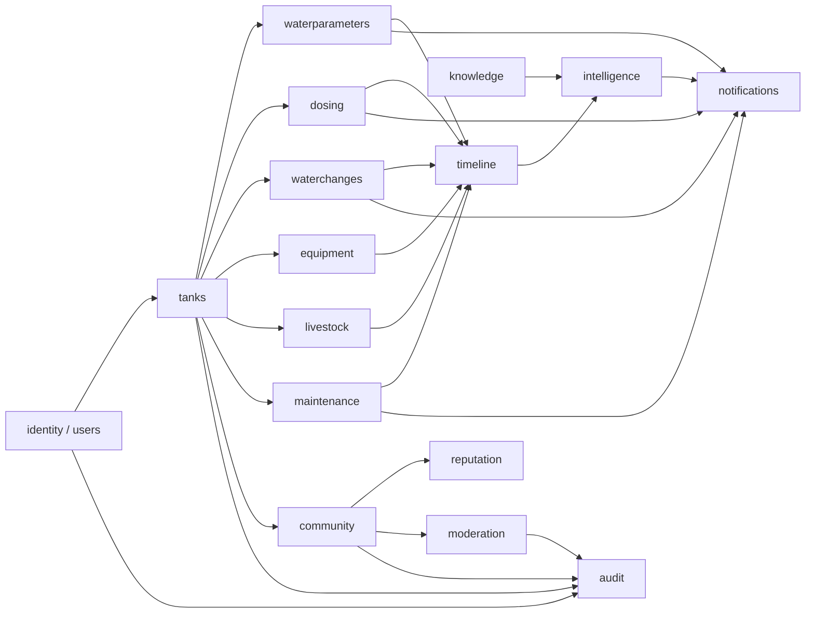
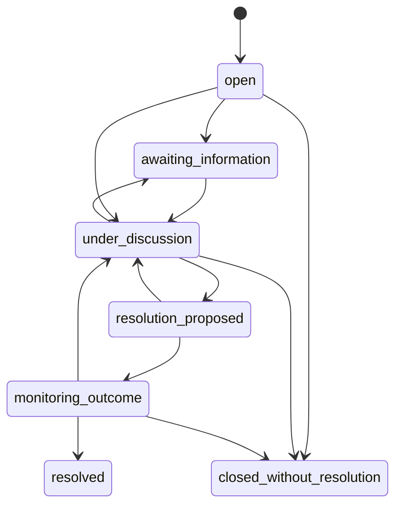

# ReefCare — Domain Model

Status: **Draft for review** (Phase 0)

This document defines the domain concepts, their invariants and how modules relate. The physical
schema is in [database-design.md](database-design.md).

## 1. Bounded contexts (modules)

Arrows mean "depends on / reads from". Modules never write into another module's tables; they
call that module's application service or publish a timeline event in the same transaction.

## 2. Core concepts

### Identity
- **User** — account with email, password hash, status (`active`, `suspended`, `deactivated`),
  profile, preferences (language, timezone, units, notifications).
- **Role** — authorization role: `user` (implicit), `moderator`, `administrator`. Independent of rank.
- **Session** — opaque, server-side, revocable.

### Tank
- **Tank** — owned by one user. Holds *display volume*, *sump volume* and *estimated system volume*
  as separate quantities. Status: `cycling`, `active`, `paused`, `archived`.
- **TankShare** — grants another user `viewer` access to a tank.
- **Visibility profile** — per data category (parameters, dosing, livestock, equipment, photos):
  what may be included in public snapshots.

Invariants: a tank has exactly one owner; archived tanks are read-only; tanks with history are
never hard-deleted by users.

### Water parameters
- **ParameterType** — catalog entry (`alkalinity`, `calcium`, `magnesium`, `ph`, `temperature`,
  `salinity`, `nitrate`, `phosphate`, `ammonia`, `nitrite`, plus custom). Defines canonical unit,
  allowed input units, hard bounds and default freshness window.
- **WaterTest** — one testing session at `measured_at` (one or many readings).
- **Reading** — parameter value in original unit + canonical value; method, kit/device, source
  (`manual`, `imported`, `sensor`), status (`valid`, `superseded`, `flagged`).
- **Correction** — a new reading with `supersedes_id`; the old reading becomes `superseded`.
- **ParameterTarget** — versioned min / ideal / max per tank and parameter, valid from a time.

Canonical units (stored in `canonical_value`):

| Parameter | Canonical | Accepted input units |
|---|---|---|
| Alkalinity | dKH | dKH, meq/L, ppm (as CaCO3) |
| Calcium | mg/L | mg/L, ppm |
| Magnesium | mg/L | mg/L, ppm |
| pH | pH | pH |
| Temperature | °C | °C, °F |
| Salinity | ppt | ppt, PSU, SG (with reference temperature) |
| Nitrate | mg/L NO3 | mg/L NO3, mg/L NO3-N, ppm |
| Phosphate | mg/L PO4 | mg/L PO4, mg/L PO4-P, ppb PO4, ppm |
| Ammonia | mg/L (total NH3/NH4+) | mg/L, ppm |
| Nitrite | mg/L NO2 | mg/L NO2, ppm |

`ppm` is treated as mg/L for dilute seawater measurements, documented as an approximation.
Conversion factors (to be reviewed by `reef-domain-expert` before implementation):
1 meq/L = 2.8 dKH; 1 dKH = 17.86 ppm CaCO3; NO3 = NO3-N × 4.427; PO4 = PO4-P × 3.066;
°C = (°F − 32) × 5/9. SG ↔ ppt depends on temperature and is computed with a documented seawater
equation; the result is labeled an estimate.

### Dosing
- **DosingProduct** — global (curated) or user-private; manufacturer, category, components,
  documented concentration (optional, with source), dosage instructions, unit, warnings.
- **ProductStock** — user's container(s) of a product: size, opened date, batch, expiry, remaining.
- **DosingPlan** — tank + product + amount + unit + schedule (RRULE subset) + timezone + start/end +
  delivery method + target parameters + status (`active`, `paused`, `completed`).
- **DosingOccurrence/Event** — one scheduled or ad-hoc dose. `scheduled_for` (nullable for
  ad-hoc), planned amount, actual amount, status (`scheduled`, `completed`, `partial`, `skipped`,
  `failed`, `missed`, `cancelled`), `executed_at`, reporter (`manual`, `device`), reason.

Invariants: actual amount ≥ 0; `completed`/`partial` require `executed_at`; `skipped`/`failed`
require a reason; at most one occurrence per (plan, scheduled_for); `missed` is set only by the
scheduler and can later be resolved by the user to any terminal status (recorded as correction).

### Water changes
- **WaterChangeSchedule** — RRULE or one-time; planned volume; salt mix; targets.
- **WaterChangeEvent** — occurrence with status (`scheduled`, `completed`, `skipped`, `overdue`
  derived), actual volume, preparation details, pre/post test links.

Estimate: replaced fraction `f = actual_volume / system_volume`; after `n` equal changes with new
water at concentration `C_new`: `C_n = C_new + (C_0 − C_new)(1 − f)^n` (assumes complete mixing and
constant system volume — always shown with the result).

### Equipment & maintenance
- **EquipmentModel** — manufacturer + model + category + specs (shared catalog, user-extensible).
- **TankEquipment** — instance on a tank (serial, purchase, warranty, installed/removed dates).
- **EquipmentConfiguration** — versioned settings (e.g. light schedule, pump speed); each new
  version emits a timeline event.
- **MaintenancePlan / MaintenanceEvent** — interval-based tasks (clean skimmer, replace carbon,
  calibrate probe), optionally tied to equipment.

### Livestock
- **Species** — reference (common/scientific name, category: fish, coral, invertebrate, other;
  coral type: SPS, LPS, soft).
- **LivestockEntry** — a group of individuals of one species in a tank (name, location, source,
  frag/colony, quarantine status).
- **LivestockEvent** — `added`, `died`, `transferred_out`, `transferred_in`, `sold`,
  `reconciliation`, `health_observation`, `treatment`; quantity delta (0 for observations).

Invariant: `current_quantity = Σ quantity_delta ≥ 0` at every point in event order; enforced in
the service under a row lock on the entry and mirrored in a cached column with a CHECK ≥ 0.

### Timeline
- **TankEvent** — append-only projection: tank, `occurred_at`, category, type, source module +
  source id, actor, short summary payload. Written in the same transaction as the source change.

Categories: `measurement`, `dosing`, `water_change`, `equipment`, `maintenance`, `livestock`,
`symptom`, `treatment`, `milestone`, `note`, `assessment`.

### Knowledge & intelligence
- **KnowledgeArticle** — stable slug/id, category; **KnowledgeArticleVersion** — content,
  structured facts, conditions, parameters/symptoms, explanations, verifications, recommendations,
  contraindications, claim class, review status; **KnowledgeSource** — citation metadata.
- **Rule** — code-defined, versioned (`rule_version`), references knowledge article ids.
- **Assessment** — immutable result + input snapshot + evidence + references; **AssessmentFeedback**.
See [knowledge-engine.md](knowledge-engine.md).

### Notifications & jobs
- **Job** — persistent unit of scheduled work with dedupe key, run_at, attempts, status.
- **Notification** — per user, category, payload, read state, delivery state per channel.

### Community (Release 2)
- **Post** (`discussion` | `case`), **CaseSnapshot** (immutable JSONB of shared tank context),
  **Comment** (answers and replies), **Vote**, **CaseUpdate**, **Media**.
- **ReputationLedgerEntry**, **Badge**, **UserBadge**, rank thresholds (config).
- **ModerationReport**, **ModerationAction**.

Case lifecycle:

## 3. Authorization model

`Policy(actor, action, resource)` evaluated in application services:

| Action | Owner | Viewer (share) | Other user | Moderator | Admin |
|---|---|---|---|---|---|
| Read tank & data | ✔ | ✔ | ✘ (404) | ✘ | support access only, audited |
| Modify tank data | ✔ | ✘ | ✘ | ✘ | ✘ |
| Share / visibility | ✔ | ✘ | ✘ | ✘ | ✘ |
| Read public case | ✔ | ✔ | ✔ | ✔ | ✔ |
| Moderate content | ✘ | ✘ | ✘ | ✔ | ✔ |
| Manage roles/accounts | ✘ | ✘ | ✘ | ✘ | ✔ |

Reputation rank has no effect on this table.
