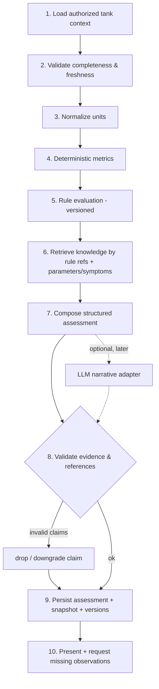

# ReefCare — Knowledge Base and Reef Intelligence Engine

Status: **Draft for review** (Phase 0)

## 1. Purpose and boundaries

The engine turns a tank's structured history into **provisional assessments**: what the data
shows, what it might mean, what evidence supports or contradicts each possibility, and what to
verify next. It is **not** a diagnostic system and never acts on equipment.

Design constraints:
1. Deterministic first. Metrics and rules run without any LLM and are fully testable.
2. Evidence-linked. Every claim points to stored readings/events or a reviewed knowledge version.
3. Reproducible. Each assessment stores its input snapshot, rule version and knowledge version.
4. Honest about uncertainty. Missing/stale data is reported, not papered over.

## 2. Knowledge base

### Content model
- `knowledge_articles` (stable `slug`, category) → `knowledge_article_versions` (immutable once
  published; edits create a new version) → `knowledge_sources` (citations).
- Structured fields used by rules: `parameters[]`, `symptoms[]`, `conditions` (e.g.
  `{"parameter":"alkalinity","change_per_day_gt":"0.5"}`), `verifications[]`,
  `recommendations[]` (each conditional), `contraindications[]`, `safety_warnings[]`.
- **Claim class** per version and per recommendation: `established` (scientific or manufacturer
  documented), `expert` (reviewed interpretation), `community` (reported experience),
  `unverified` (hypothesis). Rules may only produce *recommendations* from `established` or
  `expert` items; `community`/`unverified` may appear only as labeled alternative explanations.
- Review workflow: `draft → in_review → published → retired`. Publishing requires a reviewer
  (admin or verified specialist) different from the author. Only the author edits and submits
  a draft, so the reviewer can never publish words they wrote (implemented in 3.1; the
  database trigger enforces the transitions and freezes content, author and review record).
  A recommendation never claims a stronger class than its version. Community anecdotes are never
  auto-promoted.
- Locales: each version has a `locale`; `vi` and `en` versions of the same article share the slug.
- `knowledge_version` (string) = hash of the set of published version ids used by the rule set at
  assessment time.

### Seed content (MVP)
Small, reviewed set backing MVP rules only, e.g.: alkalinity stability, calcium/alkalinity/magnesium
relationship, nitrate & phosphate basics, salinity measurement and refractometer calibration,
temperature stability, nitrogen cycle and ammonia/nitrite in established tanks, test-kit accuracy
and re-testing. **No sources are invented**; where a source cannot be verified the article is
marked `unverified` and kept out of recommendation paths.

## 3. Pipeline



1. **Load** (service layer, after `Authorizer.Require(read)`): last 90 days of readings, current and
   historical targets, dosing plans + events, water changes, equipment config changes, livestock
   events, symptom/treatment notes, tank volumes and type. Only this tank's data.
2. **Validate**: per parameter, count and age of readings vs freshness window; detect gaps,
   conflicting readings (two readings of same parameter within 2 h differing beyond kit tolerance),
   flagged readings.
3. **Normalize**: canonical units already stored; re-verify conversions; reject unknown units.
4. **Metrics** (pure functions, `shopspring/decimal`):
   - latest value, age, delta vs previous, rolling mean/min/max (7/30 days)
   - linear slope per day (least squares over window, min 3 points)
   - variability: max day-to-day change, range within 7 days
   - target status: below / within / above, using the target valid at `measured_at`
   - dosing adherence: completed vs scheduled occurrences, planned vs actual totals
   - water-change cadence and estimated replaced fraction
   - livestock losses in window
5. **Rules**: code-defined, each with id, version, inputs, preconditions (data sufficiency),
   condition, output template, knowledge refs, safety warnings. `rule_version` = semver of the rule
   set.
6. **Knowledge retrieval**: by rule-declared article slugs plus parameter/symptom tags; published
   versions only, in the user's locale with fallback.
7. **Compose** the typed model (below).
8. **Validate**: each evidence id exists and belongs to the tank; each knowledge ref is a published
   version; hypotheses without supporting evidence are removed; recommendations from
   non-`established`/`expert` items are demoted to "things others have reported".
9. **Persist** in one transaction with `assessment_evidence`, refs, and a timeline event.
10. **Present**: summary, observations, hypotheses, verifications, warnings; prompt for missing data.

## 4. Output model

```go
type Assessment struct {
    ID                    uuid.UUID
    TankID                uuid.UUID
    Type                  AssessmentType   // parameter_deviation, parameter_instability, dosing_mismatch,
                                           // equipment_suspect, livestock_change, change_symptom_link,
                                           // data_quality, next_measurements
    Status                string
    Summary               Text             // i18n key + params
    Observations          []Observation    // factual, each with EvidenceRefs
    Hypotheses            []Hypothesis
    AlternativeExplanations []Hypothesis
    MissingInformation    []MissingItem
    RecommendedVerifications []Verification
    SafetyWarnings        []SafetyWarning
    KnowledgeReferences   []KnowledgeRef   // article version ids
    ConfidenceLabel       Confidence       // low | moderate | high | not_assessed
    InputSnapshotVersion  int
    RuleVersion           string
    KnowledgeVersion      string
    CreatedAt             time.Time
}

type Hypothesis struct {
    Key          string
    Statement    Text
    ClaimClass   ClaimClass
    Supporting   []EvidenceRef
    Contradicting []EvidenceRef
    Missing      []MissingItem
}
```

### Confidence basis (documented, not probabilistic)
- `not_assessed`: data sufficiency precondition failed.
- `low`: one supporting data point, or any contradicting evidence, or any input stale.
- `moderate`: ≥ 2 independent supporting readings within freshness, no contradicting evidence.
- `high`: `moderate` conditions **and** confirmation by a repeat test or a second method/kit.
No percentages are shown.

## 5. MVP rule set (v1.0.0)

| Rule id | Type | Preconditions | Condition (initial thresholds, reviewable) | Output highlights |
|---|---|---|---|---|
| `DQ-STALE` | data_quality | — | latest reading older than freshness window, or none | lists parameters to test |
| `DQ-CONFLICT` | data_quality | ≥ 2 readings within 2 h | difference > kit tolerance | ask to re-test / check kit |
| `DQ-IMPLAUSIBLE-JUMP` | data_quality | previous reading ≤ 7 days | change exceeds parameter-specific "suspicious jump" (e.g. alk > 1.5 dKH/day, salinity > 2 ppt/day) | **re-test before acting** |
| `PD-OUT-OF-TARGET` | parameter_deviation | reading fresh | outside current target | hypotheses from rule-linked knowledge; verifications |
| `PI-ALK-SWING` | parameter_instability | ≥ 3 alk readings in 7 days | range > 1.0 dKH in 7 days | relate to dosing adherence & water changes as *possible* links |
| `PI-TREND` | parameter_instability | ≥ 3 points over ≥ 5 days | slope projects leaving target within 7 days | early notice, no correction amount |
| `DM-ADHERENCE` | dosing_mismatch | active plan with target parameter | < 80% of occurrences completed in 7 days and target parameter trending away | suggests checking dosing records/pump |
| `LC-LOSSES` | livestock_change | — | ≥ 2 deaths in 7 days or any loss after a recent change event (≤ 72 h) | welfare escalation warning; temporal link labeled *correlation* |
| `NH-AMMONIA-NITRITE` | parameter_deviation | tank status `active` | ammonia or nitrite > hard welfare threshold | **urgent** warning; verify with second test; escalation guidance |
| `NM-NEXT` | next_measurements | always | — | recommended tests based on stale data and tank type |

What counts as a loss for `LC-LOSSES` (livestock events, milestone 2.7):
- **Death:** only `died` (a death the keeper saw).
- **Unaccounted for:** `missing` is reported separately as "unaccounted for", never as a death.
- **Not a loss:** `sold` and `transferred_out` (moved, rehomed, traded, returned).
- **Count correction:** a negative `reconciliation` is at most "unexplained decrease (count
  correction)". A large one (e.g. a clean-up crew recounted from 30 to 12) may prompt the
  keeper to look; it is never stated as deaths.
- **Not a new arrival:** `propagated` (fragging, splitting, reproduction) is not an arrival from
  outside; only `added` (and `transferred_in` from another tank) count for "recent new arrival"
  rules.
- **Observations:** `health_observation` and `treatment` notes are the keeper's words. Rules
  never turn them into a disease name and never suggest a treatment.

### As implemented (milestones 3.2/3.3, `internal/intelligence`, rule set 1.0.0)

Pure functions over an authorized snapshot (`Evaluate(Snapshot) Result`), golden-tested on the
fixtures in `internal/intelligence/testdata`. Changes from the table above, after the
reef-domain and code reviews:
- `DQ-IMPLAUSIBLE-JUMP` became `DQ-FAST-CHANGE`: a change beyond kit tolerance, measured per day
  over at least a day (short gaps never inflate it), between readings 2 h–7 days apart; it may be
  real (stuck doser, ATO failure), so the wording is "confirm with a re-test", not "test error".
  Temperature is excluded: fast temperature changes are usually real.
- `DQ-CONFLICT` only looks at the latest pair; an agreeing re-test resolves an older conflict.
  Readings of a conflicting pair are left out of swing and trend analysis.
- A doubtful parameter (fast change or conflict) suppresses `PI-ALK-SWING` and `PI-TREND`; other
  findings about it stay, with low confidence.
- New `WB-WELFARE-BOUNDS`: fixed bounds that apply without targets — temperature urgent ≥ 30 °C or
  ≤ 20 °C (warning > 28.5), salinity urgent < 28 or > 40 ppt (fish-only: "if not intentional"),
  pH urgent < 7.5 or > 8.7, alkalinity warning < 5 or > 14 dKH (reef types).
- `NH-AMMONIA-NITRITE`: detected (ammonia ≥ 0.05, nitrite ≥ 0.1) is a warning; urgent at ≥ 0.25
  mg/L NH3 / ≥ 1 mg/L NO2, for any tank with animals (fish-in cycles included); a fishless
  cycling tank gets an informational "cycle progress" item; an elevated reading that went stale
  asks for a re-test. Ammonia and nitrite stay core parameters until a clean reading (and while
  cycling, go stale after 3 days).
- `PD-OUT-OF-TARGET` severity grows with the distance outside the target (> half the target
  width: warning). Its "measurement problem" hypothesis is supported by in-range readings since
  the deviation began, contradicted by repeated out-of-range ones, and omitted once a second
  known kit confirms the deviation.
- `PI-ALK-SWING` needs readings going both up and down (a steady correction is not a swing);
  confidence at most moderate. `PI-TREND` fits the last 14 days and ignores moves within kit
  tolerance.
- `DM-ADHERENCE` counts active manual plans only and reports the records alone: plans have no
  target parameter yet (open item DS2), so "target parameter trending away" is not checked.
- `LC-LOSSES` counts individuals (≥ 2 in 7 days) or a death ≤ 72 h after a change (correlation);
  urgent only together with a welfare or ammonia/nitrite alarm (two deaths can be routine in a
  large clean-up crew).
- Temperature findings carry "check heater/chiller now" instead of "no fast corrections".
- Confidence "high" needs a second *known* method or kit; readings converted from SG never count.
- Kit tolerances (canonical units): alkalinity 0.5, calcium 25, magnesium 100, pH 0.25,
  temperature 1, salinity 1.5 (2 when converted from SG), nitrate max(2.5, 20 %), phosphate
  max(0.05, 15 %), ammonia/nitrite 0.1.

Thresholds are product decisions to be reviewed by a reef-domain reviewer before release
(decision D5) and live in versioned rule code, not in user-editable config.

## 6. Safety rules (enforced in validation step)

- No causal language ("caused by"); templates use "may be related to", "coincides with".
- No dose-correction amounts in MVP. Correction calculators (later) must cap per-day change,
  require recent confirmed readings and show assumptions.
- No image-only conclusions (images aren't analyzed in MVP).
- Urgent welfare warnings (ammonia/nitrite, rapid losses, temperature extremes) always included
  when triggered and cannot be removed by later steps.
- Never trigger device or dosing actions; assessments have no side effects except persistence and
  notifications.

## 7. Triggers

- Manual (`POST /tanks/{id}/assessments`), rate limited.
- After a water test (job `intelligence.assess_after_test`; implemented as one job per tank per
  10-minute bucket, run at the end of the bucket on the latest state, ≤ 24 per tank per day).
- Daily staleness (`DQ-STALE` only, produces notification, not a full assessment).

## 8. LLM integration (later, optional)

```go
type NarrativeGenerator interface {
    Narrate(ctx context.Context, in NarrativeInput) (NarrativeOutput, error)
}
```
- `NarrativeInput`: the composed deterministic assessment + knowledge excerpts; no PII.
- Output may only rephrase summary and explanations, and propose hypotheses referencing **existing**
  evidence ids and knowledge version ids; validation step 8 rejects anything else.
- Timeouts (10 s), no retries on 4xx, circuit breaker; when unavailable the deterministic assessment
  is returned unchanged (`narrative: null`).
- Provider configured by `LLM_PROVIDER` (default `none`).

As implemented (3.6, `internal/intelligence/narrative.go`): the interface, `ValidateNarrative`
(explanations of existing findings; hypotheses that cite only facts and knowledge versions the
finding already cites; length and character checks), a guard with a 10 s timeout, no retries and
a circuit breaker (5 consecutive failures → 5 min pause), called outside any transaction. Only
`LLM_PROVIDER=none` exists (decided 2026-10-31); a provider is a separate, reviewed change (open
item IN13). Narrative hypotheses are shown apart from the findings, as unverified.

## 9. Testing

Fixture tanks in `internal/intelligence/testdata/` (JSON): stable tank, alk swing, stale data,
conflicting readings, mixed units, ammonia spike, losses after equipment change, LLM down.
Golden-file tests compare rule outputs; property tests check that every hypothesis has ≥ 1
supporting evidence and every knowledge ref exists.

## 10. Feedback loop

`assessment_feedback` (useful / not useful / wrong + outcome). Reviewers use "wrong" feedback to
adjust rules (new `rule_version`) or knowledge (new article version). Past assessments are never
rewritten; they can be marked `retracted` with a reason.
